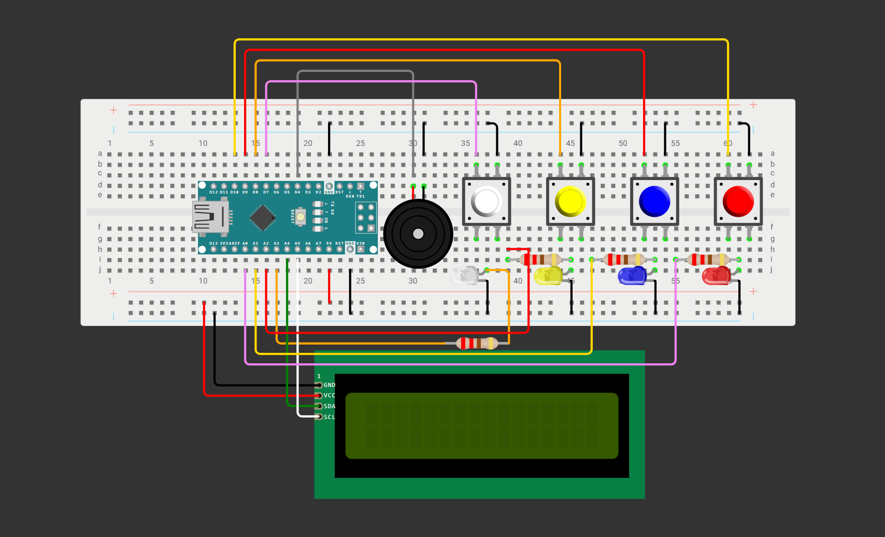

# Simon Says Game

A Simon Says Game using **four LEDs and buttons along with a passive buzzer**.

---

## 🚀 How It Works

The LEDs and buzzer flash and tone. When it's finished, the player must replicate the exact pattern using the pushbuttons. The Arduino randomly chooses the pattern in which the LEDs flash, and each LED has a unique tone. If the player fails to replicate the pattern, they must start over. If they reach the maximum number of levels, they win.

### Hardware
- **Development Board:** Arduino Nano
- **Main Components:** Passive Buzzer + I2C LCD + LEDs + Pushbuttons
- **Software:** Arduino IDE

### Cool Features
- Unique tones for each LED
- Victory music
- Ability to reset (using watchdog timer)
- Game speeding up after each level
- Cheat Mode
- Portability
- Amplified sound (using transistor and diode)

---

## 📊 Circuit Layouts

### Wiring Diagram

Below is the wiring diagram for the project:

**Note: This wiring diagram was made in Wokwi. Since Wokwi doesn't have a Power MB V2, transistor, or diode in the actual build, the wiring diagram is an approximation of the physical build but retains the correct wiring and functionality.**

### Schematic

Below is the schematic generated in Tinkercad:

*Schematic coming soon*

## 🔗 Wokwi Simulation
Try the interactive simulation of the project here:

[Open in Wokwi](SIMULATION_NOT_READY)

---
## 🖼️ Project Photo

See the project (may have some issues viewing it on desktop):

[Click here](Simon_Says_Game_Image.png)

## 🎥 Video Demonstration

Watch the project in action + an explanation of the build:

[▶ Watch the Video](NOT_READY)

---

## 📁 Repository Contents

- `Simon_Says_Game.ino` — Arduino source code
- `README.md` — Project documentation
- `LICENSE` — Apache License 2.0
- `Simon_Says_Game_Image.png` — Project photo
- `Simon_Says_Game.png` — Wiring Diagram 
- `Schematic.png` — Coming Soon!

---

## 🛠️ Components Used

- Arduino Nano Board
- Passive Buzzer
- 4 LEDs + Pushbuttons
- I2C LCD
- Transistor
- Diode
- Resistors
- Power MB V2 + 9V Battery
- Jumper wires

---

## 💡 What I Learned

I learned to go back and make my games playable. Since my original code contained 100 max levels of play, which is nearly impossible, I had to go back and reduce it to a manageable amount. Therefore, I think this project has demonstrated my ability to go back and reanalyze my build.

---

## 📜 License

This project is licensed under the Apache License 2.0.
